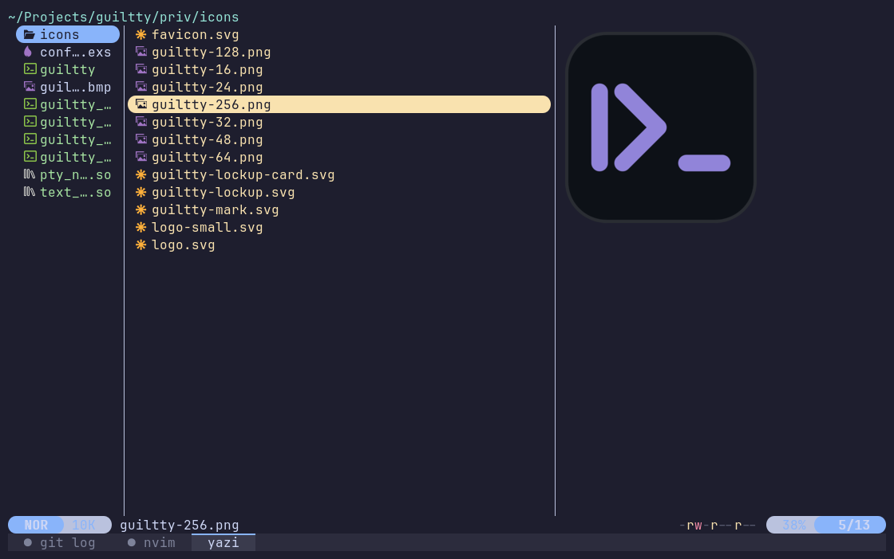

<p align="center">
  
</p>

# guiltty

A GPU terminal emulator in Elixir and C. Elixir holds the behavior: the
parser, the screen, tabs, windows, config. C does the syscalls, the hot
path and the pixels: two NIFs (the PTY, and printed text into screen
cells), a renderer (Vulkan, or OpenGL) that runs as its own process, and
the small `guiltty` command.

<p align="center">
  
</p>

Linux only. Tried on openSUSE Tumbleweed, on X11 and on Wayland (GNOME), with
an AMD GPU; Intel, NVIDIA and other distributions should work but haven't been
tried.

It isn't fast at heavy output: a big `cat` goes by at about 3 to 8 MB/s,
plain ASCII at the low end, text with accents, CJK or emoji at the high
end (book chapter 22).

## Install

One line, on any x86_64 Linux with glibc 2.36 or newer: Ubuntu 23.04 or
newer, Debian 12 or newer, and any current Fedora, Arch, Manjaro or
openSUSE:

```sh
curl -fsSL https://raw.githubusercontent.com/z7ealth/guiltty/master/install.sh | bash
```

Ubuntu's desktop has no curl; wget does the same:

```sh
wget -qO- https://raw.githubusercontent.com/z7ealth/guiltty/master/install.sh | bash
```

That downloads the latest precompiled release (about 10 MB, with its own
Erlang inside: no Elixir, no compiler) and installs it into `~/.local`,
no root needed:

| Where                                             | What            |
|---------------------------------------------------|-----------------|
| `~/.local/lib/guiltty/`                           | the release     |
| `~/.local/bin/guiltty`                            | the command     |
| `~/.local/share/applications/guiltty.desktop`     | the menu entry  |
| `~/.local/share/icons/hicolor/*/apps/guiltty.png` | the icon        |

If a library guiltty needs is missing (fontconfig, FreeType, HarfBuzz,
libpng; every desktop normally has them), it shows the `sudo` command that
installs it and asks before running it. On a system too old for the
release (Ubuntu 22.04, Debian 11), it says so and installs nothing. Then
run `guiltty`, or find it in your applications menu. If your shell says
`guiltty: command not found`, log in again (Ubuntu and Fedora add
`~/.local/bin` to your `PATH` at login once it exists) or add it yourself.

Options go after `bash -s --`, settings before `bash`:

| To                         | Run                                                       |
|----------------------------|-----------------------------------------------------------|
| update                     | the same line again                                       |
| uninstall (config stays)   | `curl -fsSL …/install.sh \| bash -s -- --uninstall`        |
| not be asked anything      | `curl -fsSL …/install.sh \| bash -s -- --yes`              |
| install a given version    | `curl -fsSL …/install.sh \| GUILTTY_VERSION=v0.26.1 bash` |
| install somewhere else     | `curl -fsSL …/install.sh \| PREFIX=/opt/guiltty bash`      |

(`…` is `https://raw.githubusercontent.com/z7ealth/guiltty/master`.)

When updating, if guiltty is running, the script asks before stopping
it, since that closes its tabs. Run from a guiltty tab, it finishes after
that tab closes, then opens guiltty again (its output goes to
`~/.local/state/guiltty/install.log`).

[install.sh](install.sh) is a short script: read it first, if you like.

guiltty needs a GPU driver with OpenGL 3.3, which almost any desktop from
the last decade has. With a Vulkan 1.3 driver (Mesa's, for AMD and Intel
GPUs; only AMD has been tried), it draws with Vulkan; without one, as in
most virtual machines, it draws with OpenGL, silently: that's a normal
way to run.

Fonts come from fontconfig. guiltty looks best with a Nerd Font (for
prompt icons), Noto Color Emoji (for emoji) and a CJK font such as Noto
Sans CJK, for Chinese and Japanese.

### Manual install

Without piping a script into your shell: download the release from the
[releases page](https://github.com/z7ealth/guiltty/releases), check it
and run the `install.sh` inside it. It's the same script, and it installs
that tarball instead of downloading one:

```sh
v=0.26.1
curl -fLO https://github.com/z7ealth/guiltty/releases/download/v$v/guiltty-$v-x86_64-linux.tar.gz
curl -fLO https://github.com/z7ealth/guiltty/releases/download/v$v/guiltty-$v-x86_64-linux.tar.gz.sha256
sha256sum -c guiltty-$v-x86_64-linux.tar.gz.sha256      # should say: OK
tar xzf guiltty-$v-x86_64-linux.tar.gz
./guiltty-$v-x86_64-linux/install.sh                    # --uninstall, --yes work here too
```

### Entirely by hand

Without any script. This is all that install.sh does.

1. The libraries, if they're missing:

   | Distribution         | Command                                                                          |
   |----------------------|----------------------------------------------------------------------------------|
   | openSUSE             | `sudo zypper install fontconfig libfreetype6 libharfbuzz0 libpng16-16 libvulkan1` |
   | Fedora               | `sudo dnf install fontconfig freetype harfbuzz libpng vulkan-loader`              |
   | Ubuntu, Debian       | `sudo apt install libfontconfig1 libfreetype6 libharfbuzz0b libpng16-16 libvulkan1` |
   | Arch, Manjaro        | `sudo pacman -Syu --needed fontconfig freetype2 harfbuzz libpng vulkan-icd-loader` |

2. The release, the command, the icons and the menu entry (after
   unpacking the tarball as above):

   ```sh
   v=0.26.1
   mkdir -p ~/.local/lib ~/.local/bin ~/.local/share/applications
   cp -a guiltty-$v-x86_64-linux/release ~/.local/lib/guiltty
   ln -sf ~/.local/lib/guiltty/lib/guiltty-$v/priv/guiltty ~/.local/bin/guiltty
   for s in 16 24 32 48 64 128 256; do
     install -D -m 644 ~/.local/lib/guiltty/lib/guiltty-$v/priv/icons/guiltty-$s.png \
       ~/.local/share/icons/hicolor/${s}x$s/apps/guiltty.png
   done
   cat > ~/.local/share/applications/guiltty.desktop <<EOF
   [Desktop Entry]
   Type=Application
   Name=guiltty
   GenericName=Terminal
   Comment=A GPU terminal emulator in Elixir and C
   Exec=$HOME/.local/bin/guiltty
   Icon=guiltty
   Terminal=false
   Categories=System;TerminalEmulator;
   StartupWMClass=guiltty
   StartupNotify=false
   EOF
   ```

   The command has to be a link into the release, not a copy: it finds
   the release it belongs to through the link.

3. To update, stop guiltty first (`~/.local/lib/guiltty/bin/guiltty
   stop`; that closes its tabs), then replace `~/.local/lib/guiltty` and
   the link. To uninstall, remove those, the menu entry and the icons.

## Build from source

For working on guiltty, or on a machine the precompiled release doesn't
run on. The same `install.sh`, run in a git checkout, builds guiltty
there and installs it the same way.

### 1. What to install first

| What                                       | Why                                      |
|--------------------------------------------|------------------------------------------|
| Elixir 1.18 or newer, Erlang/OTP 26 or newer | building guiltty and its release       |
| GCC 15 or newer, make, pkg-config          | the C is C23 and uses `#embed` (GCC 15+) |
| SDL3 (development files)                   | the window, keyboard and mouse           |
| FreeType, fontconfig, HarfBuzz (dev files) | finding fonts, drawing and shaping text  |
| libpng (development files)                 | pictures programs show (Kitty graphics)  |
| Vulkan loader and headers (dev files)      | the Vulkan renderer                      |
| glslc (from shaderc)                       | compiles the Vulkan shaders to SPIR-V    |

Your distribution's packages work if they're recent enough; for Elixir
and Erlang, a version manager such as [asdf](https://asdf-vm.com) gets
you exact versions. `elixir --version` should say Elixir 1.18 or newer, compiled with
Erlang/OTP 26 or newer.

On these distributions, one command installs it all. openSUSE
Tumbleweed has been tried all the way to a running guiltty; on the
others, these package names were found in fresh containers of each, but
the build itself hasn't been tried.

**openSUSE Tumbleweed**

```sh
sudo zypper install gcc make pkg-config SDL3-devel freetype2-devel \
  fontconfig-devel harfbuzz-devel libpng16-devel vulkan-devel shaderc elixir erlang-epmd
```

**Fedora 45 or newer**

```sh
sudo dnf install gcc make pkgconf-pkg-config SDL3-devel freetype-devel \
  fontconfig-devel harfbuzz-devel libpng-devel vulkan-loader-devel vulkan-headers glslc elixir
```

If Fedora's Elixir is older than 1.18 (`elixir --version`), leave out
`elixir` and get Elixir and Erlang from asdf.

**Ubuntu 26.04 LTS or newer**

```sh
sudo apt install build-essential pkg-config libsdl3-dev libfreetype-dev \
  libfontconfig-dev libharfbuzz-dev libpng-dev libvulkan-dev glslc elixir erlang-dev
```

Older Ubuntus have neither SDL3 nor GCC 15.

**Arch Linux**

```sh
sudo pacman -Syu --needed base-devel sdl3 freetype2 fontconfig harfbuzz libpng \
  vulkan-icd-loader vulkan-headers shaderc elixir
```

guiltty is developed on Elixir 1.20.5 with Erlang/OTP 29, and passes its
tests on Elixir 1.18.4 with Erlang/OTP 26 too. Anything older isn't
supported. (0.24.0 to 0.26.0 couldn't open a window on OTP 26; fixed in
0.26.1.)

### 2. guiltty

```sh
git clone https://github.com/z7ealth/guiltty.git
cd guiltty
./install.sh
```

That checks for the tools above, builds a release and installs it where
the one-line install does. To update: `git pull && ./install.sh`; the
options above work here too (`./install.sh --uninstall`, `--yes`,
`PREFIX=/opt/guiltty ./install.sh`). This is also the way on a system too
old for the precompiled release, if it has the tools (GCC 15 and SDL3
are usually what's missing).

To build the precompiled release itself (it's what each version's
GitHub release carries), you need only Docker: `make dist` builds it in
a container into `_build/dist/`, and `make dist-check` installs it in
fresh containers of five distributions to see that it runs (book
chapter 17).

## Use it

Every window has its own tabs: `guiltty` (or Ctrl+Shift+N) opens another
window, and closing one never touches the others. Closing a window ends its
tabs, except the ones you lock with Ctrl+Shift+L (they show a 🔒): those
keep running, and the next `guiltty` brings that window back with them.
guiltty stops after its last window.

While a program asks for a password (`sudo`, `ssh`), a lock shows where
the cursor is: nothing you type appears, but guiltty is listening.

| Keys                          | Action                                   |
|-------------------------------|------------------------------------------|
| Ctrl+Shift+N                  | new window, with its own tabs            |
| Ctrl+Shift+T, Ctrl+Shift+W    | new tab; close the pane (the tab, when it's the last; asks first if a program is running) |
| Ctrl+Shift+O, Ctrl+Shift+E    | split the pane right, down                |
| Ctrl+Shift+arrows, a click      | focus the pane that way, or the one clicked |
| Alt+Shift+arrows         | move the separator nearest the focused pane |
| Ctrl+PgUp, Ctrl+PgDn          | previous, next tab                       |
| Ctrl+Shift+PgUp, Ctrl+Shift+PgDn | move the tab left, right              |
| Ctrl+Shift+R                  | rename the tab (Enter sets, empty resets)|
| Shift+PgUp, Shift+PgDn        | scroll back, forward (or the mouse wheel)|
| Ctrl+Shift+K                  | clear the scrollback                     |
| Ctrl+Shift+F                  | search; Enter older, Shift+Enter newer, Escape ends |
| select with the mouse         | copies to the primary selection          |
| Ctrl+Shift+A                  | select all: the scrollback and the screen |
| Ctrl+Shift+G                  | copy the last command's output (the shell must mark it: OSC 133) |
| Ctrl+Shift+J                  | label every link on screen; type a label to open it, Escape ends |
| Ctrl+Shift+C, Ctrl+Shift+V    | copy, paste (middle click pastes the selection) |
| Ctrl+= (or Ctrl and the + key), Ctrl+-, Ctrl+0 | zoom in, out, reset |
| Ctrl+,                        | open the config file in your editor      |
| Ctrl+Shift+H (or Ctrl+Shift+/) | the cheatsheet: every key, on one page  |
| Ctrl+Shift+L                  | lock the tab: it outlives the window     |
| Ctrl+Shift+B                  | broadcast: type into all tabs in the group, every pane of each (ssh) |

Hold Shift to select in programs that use the mouse (vim, htop).

A tab you're not looking at shows ● when it prints something and 🔔 when
it rings the bell (a build that ends with `; printf '\a'`, say), until you
switch to it.

## Configure it

The config file is `~/.config/guiltty/config.exs`. Ctrl+, creates it from
[priv/config.example.exs](priv/config.example.exs), which documents every
setting, and opens it in your editor: in a new tab running `$VISUAL` (or
`$EDITOR`) if one is set, otherwise in your desktop's app for the file.
guiltty reads the variable from its own environment, so set it where your
session starts (`~/.profile`, or `~/.config/environment.d/`), not only in
your shell's rc file. Saving applies most changes to the
open window. Mistakes show in red in the tab bar, so they don't go
unnoticed.

Among the settings: themes (Catppuccin Mocha and Latte, Dracula, Gruvbox,
Nord, One Dark, Solarized, Tokyo Night, Tomorrow Night, guiltty's own
lavender, or your own colors), font and size, cursor, padding,
opacity, the tab bar at the bottom (the default) or top, the tab style
(flat, powerline, rounded, minimal or separators) and the tab bar's
colors, ligatures, the shell, scrollback, and every key.

**Vulkan or OpenGL.** guiltty draws with Vulkan 1.3. If Vulkan can't
start (an old GPU, no driver), it switches to OpenGL by itself and says so
in the tab bar. With `renderer: :gl` in the config it always uses OpenGL,
starting with the next window (so one window can be Vulkan and the next
OpenGL). `GUILTTY_RENDERER=gl` does the same for a whole run, when it's
set as guiltty starts (`guiltty stop`, then `GUILTTY_RENDERER=gl guiltty`).

## Hack on it

```sh
mix deps.get
mix guiltty        # a window from the source tree; closing it ends everything
mix test
iex -S mix         # the same, with an iex shell alongside
```

`mix compile` also builds the C (the two NIFs and both renderers, each in a
normal and a debug build). To try a release without installing it:

```sh
MIX_ENV=prod mix release
_build/prod/rel/guiltty/lib/guiltty-*/priv/guiltty   # starts guiltty if needed, opens a window
```

`make bench` measures throughput (book chapter 22). `AGENTS.md` lists
every command: debug builds, replaying the renderer, regenerating the
width table and the icons.

## Learn how it works

- `book/` explains every part, with diagrams. Start at `book/index.org`.
- `CHANGELOG.md` lists what each version added.
- `DEVLOG.md` is what happened along the way.
- `AGENTS.md` has the rules for working on the code.

## License

MIT, see [LICENSE](LICENSE). The installed copy also carries the Erlang
runtime and the `telemetry` library, both under the Apache License 2.0.
The precompiled release also carries Elixir (Apache 2.0) and has SDL3
(zlib license) and ncurses (MIT-style) built in; their license texts are
in the tarball's `licenses/`.
